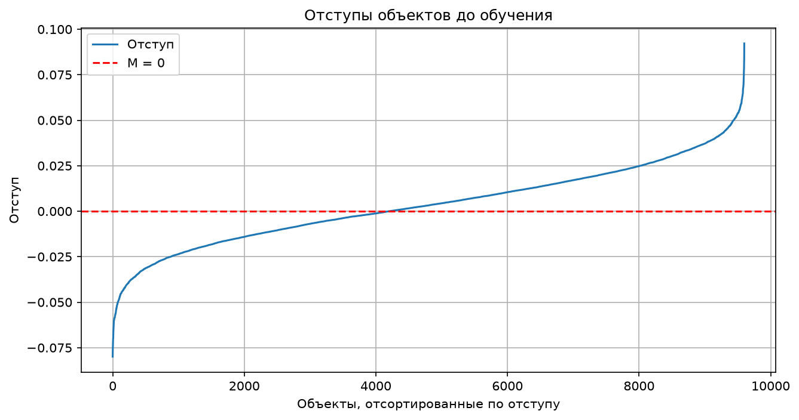
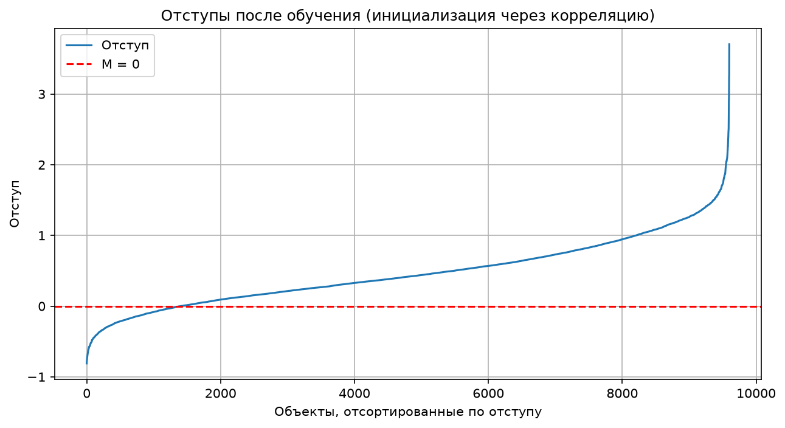
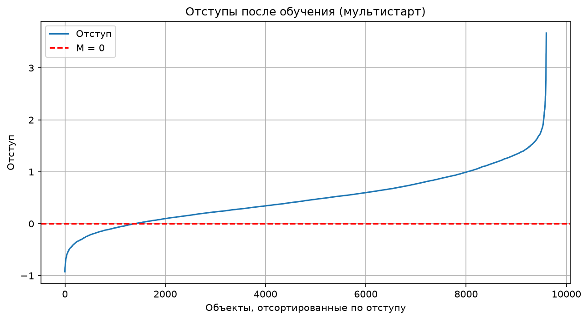
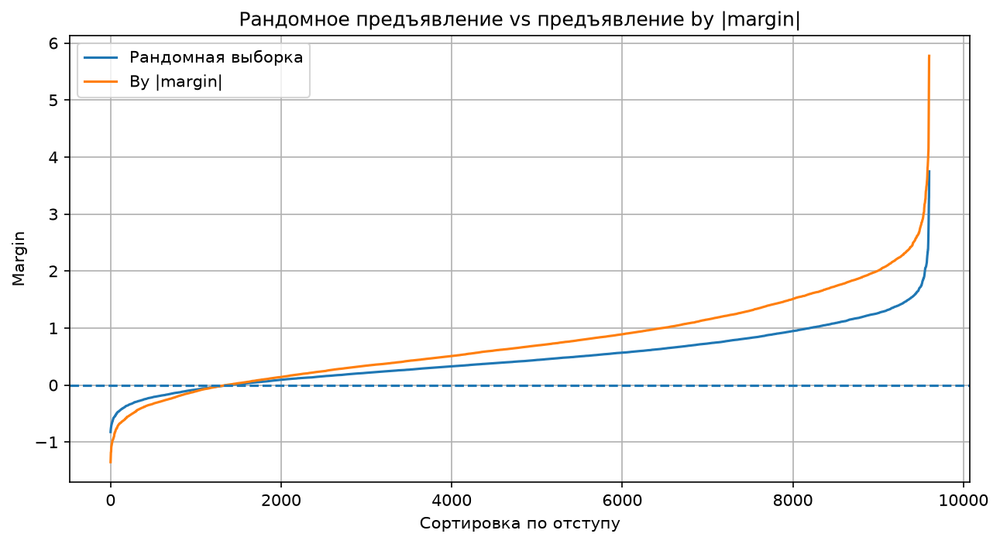
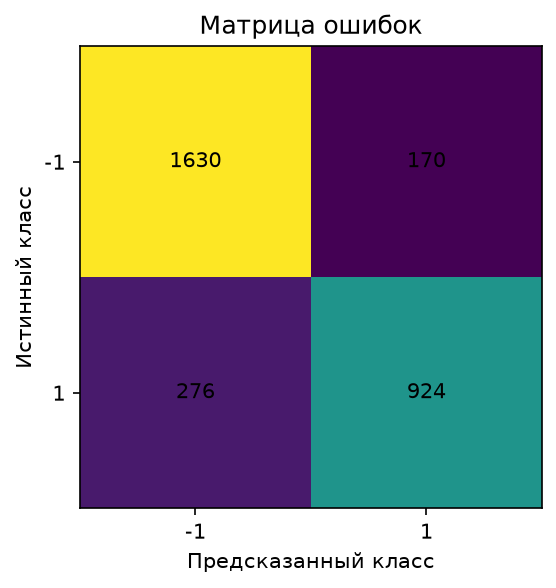
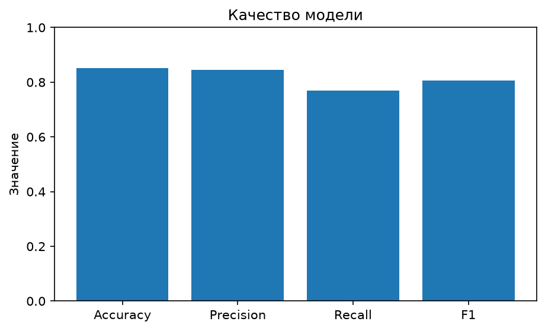

# Лабораторная работа №1. Линейная классификация

## 1. Датасет

Для задачи классификации я выбрала датасет про риск диабета. Целевая переменная — `diabetes_risk`.

**Признаки датасета:**

- `patient_id` — уникальный идентификатор пациента (исключён из признаков модели);
- `age` — возраст пациента;
- `gender` — пол пациента;
- `city` — город проживания;
- `bmi` — индекс массы тела;
- `family_history_diabetes` — наличие диабета в семейном анамнезе;
- `physical_activity_level` — уровень физической активности;
- `diet_type` — тип питания;
- `smoking_status` — статус курения;
- `alcohol_consumption` — уровень потребления алкоголя;
- `hours_sleep_per_night` — количество часов сна за ночь;
- `stress_level` — уровень стресса;
- `fasting_blood_sugar` — уровень глюкозы натощак;
- `hba1c_level` — уровень гликированного гемоглобина;
- `blood_pressure_systolic` — систолическое давление;
- `blood_pressure_diastolic` — диастолическое давление;
- `waist_circumference_cm` — окружность талии;
- `income_bracket` — категория дохода.

### Подготовка данных

Пропущенные значения есть в `smoking_status` (472), `alcohol_consumption` (3788) и `income_bracket` (463). Так как эти признаки категориальные, пропуски заполняются модой, вычисленной по обучающей выборке. Числовые признаки стандартизуются (среднее и стандартное отклонение считаются только по обучающей выборке), чтобы признаки были одного масштаба. Категориальные признаки преобразуются с помощью `pd.get_dummies`, а столбцы тестовой выборки приводятся к тем же названиям и порядку, что и в обучающей.

В исходных данных три категории риска: `Low` (9000 объектов), `Moderate` (3750) и `High` (2250). Я преобразовала задачу в бинарную классификацию: `Low` → `-1`, `Moderate` и `High` → `+1`. Получилось 9000 объектов класса `-1` (60 %) и 6000 объектов класса `+1` (40 %), выборки разделялись с сохранением этой пропорции (`stratify`).

Всего 15 000 объектов. Сначала выделено **3 000 объектов для тестирования**, оставшиеся 12 000 разделены на **9 600 для обучения и 2 400 для валидации**. Валидационная выборка нужна, чтобы выбирать лучшую собственную модель не по обучающей выборке, на которой модели обучались. После кодирования и добавления константного признака получилось по **41 столбцу** в каждой выборке.

### Обучаемый порог активации (bias)

$$
a(x) = \operatorname{sign}\left(\sum_{j=1}^{n} w_j f_j(x) - w_0\right).
$$

### 2. Вычисление отступа объекта

Дискриминантная функция с порогом:

$$
g(x_i, w) = \sum_{j=1}^{n} w_j f_j(x_i) - w_0.
$$

Отступ объекта:

$$
M_i = y_i g(x_i,w).
$$

Если `Mᵢ < 0`, объект классифицирован неправильно; если `Mᵢ > 0`, правильно. Чем ближе отступ к нулю, тем ближе объект находится к разделяющей границе.

<p align="center">
  
</p>

На графике отступы отсортированы по возрастанию. До обучения используется случайная инициализация весов (малые значения из диапазона `±1/(2n)`), поэтому все отступы лежат около нуля: от **−0,0799 до 0,0922**, среднее **0,0036**, при этом `|Mᵢ| < 0,1` у **100 %** объектов. Отрицательные отступы (ошибочная классификация) имеют **43,81 %** объектов, то есть до обучения классификатор почти не лучше случайного.

## 3. Функция потерь, градиент и рекуррентная оценка качества

Я использовала квадратичную функцию потерь:

$$
L_i(w) = (1 - M_i)^2 = (1 - y_i g(x_i,w))^2.
$$

Её градиент по **всем** обучаемым коэффициентам, включая порог `w₀`, можно компактно записать через дополненный вектор признаков `\tilde x_i = (x_i, -1)`:

$$
\nabla_{\tilde w} L_i = -2(1-M_i)y_i\tilde x_i,
\qquad \tilde w = (w_1,\ldots,w_n,w_0).
$$

В `gradient_loss()` результатом является вектор изменений всех весов.

Рекуррентная оценка качества нужна, чтобы не пересчитывать среднюю ошибку по всей обучающей выборке на каждом шаге SGD:

$$
Q_t = \lambda \xi_t + (1-\lambda)Q_{t-1},
$$

где `ξₜ` — потеря на текущем объекте, а `λ` — коэффициент забывания предыдущих значений.

## 4. L2-регуляризация

L2-регуляризация уменьшает влияние слишком больших весов:

$$
\widetilde L_i(\tilde w) = L_i(\tilde w) + \frac{\tau}{2}\sum_{j=1}^{n}w_j^2.
$$

При этом **порог `w₀` не регуляризуется**: в коде штраф считается по `w[:-1]`, а последняя компонента градиента регуляризации равна нулю. Регуляризация (`τ = 10⁻³`) применяется во всех вариантах обучения, включая скорейший спуск.

## 5. Скорейший градиентный спуск

В `SGD_steepest()` применяется оптимальный шаг для квадратичной потери **одного выбранного объекта**:

$$
h_i^* = \frac{1}{2\|\tilde x_i\|^2}.
$$

Здесь `\tilde x_i` включает константный признак `-1`. Эта формула выводится для пообъектной квадратичной потери без L2-штрафа и соответствует градиенту `-2(1-Mᵢ)yᵢ\tilde xᵢ`. В коде шаг `h_i*` считается по этой формуле, а сам градиент включает L2-компоненту, поэтому для регуляризованной задачи шаг является приближённым, а не строго оптимальным. Это именно пообъектный вариант, а не скорейший спуск по полному эмпирическому риску.

## 6. Предъявление объектов по модулю отступа

Реализована функция `choose_by_margin()`: чем меньше `|Mᵢ|`, тем выше вероятность предъявления объекта. Веса выбора и вероятности рассчитываются так:

$$
s_i = \frac{1}{|M_i|+\varepsilon},
\qquad
p_i = \frac{s_i}{\sum_{j=1}^{\ell}s_j}.
$$

Здесь `ε` предотвращает деление на ноль. Использовалось очень малое значение `ε = 10^{-8}`, из-за чего вероятность может концентрироваться на отдельных объектах с почти нулевым отступом. Вероятности пересчитываются по всей обучающей выборке на каждом шаге, поэтому этот режим работает заметно медленнее случайного предъявления. Сильная концентрация на пограничных объектах — возможная причина того, что средняя квадратичная потеря у этого режима выше, чем у остальных (см. раздел 7), но для точного подтверждения нужно дополнительно проанализировать частоты выбора объектов и динамику потерь.

## 7. Обучение моделей

Обучение выполнено методом SGD с инерцией (`γ = 0,9`), шагом `h = 10⁻³`, `λ = 0,001`, `τ = 10⁻³` и максимумом 40 000 итераций, с корреляционной инициализацией, мультистартом (5 запусков), случайным предъявлением и предъявлением по модулю отступа. Сходимость проверяется раз в 200 итераций: сравниваются `w` и `Q` с их значениями 200 итераций назад (`eps = 10⁻⁶`). Во всех запусках критерий не сработал, и обучение дошло до лимита в **40 000 итераций**. Во всех вариантах, включая скорейший спуск, обучается коэффициент порога `w₀`.

### Инициализация через корреляцию

Для инициализации используется формула `wⱼ = ⟨y, fⱼ⟩ / ⟨fⱼ, fⱼ⟩`. После дополнения матрицы признаков она применяется и к константному столбцу.

Начальные веса находятся в диапазоне от **−0,3564 до 0,6467**, норма вектора весов равна **1,5620**. Начальные отступы находятся в диапазоне **от −3,8355 до 8,7103**.

<p align="center">
  
</p>

После обучения SGD доля объектов с отрицательным отступом на обучающей выборке составляет **14,59 %**, ошибка на обучающей выборке равна **0,5074**. Качество на тесте: Accuracy **0,8480**, Precision **0,8292**, Recall **0,7808**, F1 **0,8043**. Матрица ошибок:

```text
[[1607  193]
 [ 263  937]]
```

### Случайная инициализация через мультистарт

Модель обучалась 5 раз с разными случайными начальными весами и разными последовательностями предъявления объектов. Лучший запуск выбирался по наименьшему значению функции потерь с L2-штрафом на обучающей выборке.

<p align="center">
  
</p>

Лучшей собственной моделью по ошибке на **валидационной** выборке остался **мультистарт**. Ошибка на обучающей выборке составила **0,5012**, на валидационной — **0,5130**. Доля объектов с отрицательным отступом на обучающей выборке — **14,46 %**.

На тесте: Accuracy **0,8513**, Precision **0,8446**, Recall **0,7700**, F1 **0,8056**. Матрица ошибок:

```text
[[1630  170]
 [ 276  924]]
```

Это означает, что из 1200 объектов положительного класса модель правильно определила 924, а 276 ошибочно отнесла к отрицательному классу.

### Случайное предъявление и предъявление по модулю отступа

<p align="center">
  
</p>

Результаты последнего запуска (обе модели стартуют с одинаковых начальных весов):

| Метрика | Случайное предъявление | По модулю отступа |
|---|---:|---:|
| Accuracy | 0,8463 | **0,8550** |
| Precision | **0,8279** | 0,8217 |
| Recall | 0,7775 | **0,8142** |
| F1 | 0,8019 | **0,8179** |
| Ошибка на обучении | **0,5059** | 0,6429 |
| Ошибка на валидации | **0,5143** | 0,6807 |

При предъявлении по модулю отступа модель находит больше объектов положительного класса: число ложноотрицательных уменьшилось с **267 до 223**, но число ложноположительных выросло с **194 до 212**. Благодаря этому Accuracy выросла с 0,8463 до 0,8550, Recall — с 0,7775 до 0,8142, F1 — с 0,8019 до 0,8179, а Precision немного снизилась (с 0,8279 до 0,8217).

При этом средняя квадратичная потеря у режима по модулю отступа заметно выше (0,6429 против 0,5059 на обучении). Это значит, что по доле правильных ответов модель не хуже, но отступы объектов получаются менее «аккуратными» с точки зрения минимизируемой функции. Разница в метриках небольшая (около 0,9 процентного пункта по Accuracy) и получена в одном запуске, поэтому делать вывод о стабильном преимуществе одного из способов предъявления по этому эксперименту нельзя.

## 8. Сравнение качества всех собственных моделей

| Модель | Accuracy | Precision | Recall | F1 | Ошибка на обучении | Ошибка на валидации |
|---|---:|---:|---:|---:|---:|---:|
| Корреляционная инициализация | 0,8480 | 0,8292 | 0,7808 | 0,8043 | 0,5074 | 0,5170 |
| Мультистарт | 0,8513 | **0,8446** | 0,7700 | 0,8056 | **0,5012** | **0,5130** |
| Случайное предъявление | 0,8463 | 0,8279 | 0,7775 | 0,8019 | 0,5059 | 0,5143 |
| По модулю отступа | **0,8550** | 0,8217 | **0,8142** | **0,8179** | 0,6429 | 0,6807 |
| Скорейший спуск | 0,7800 | 0,6929 | 0,8083 | 0,7462 | 1,0548 | 1,1464 |

Лучшей собственной моделью выбран мультистарт, так как у него наименьшая ошибка на валидационной выборке (выбор делается по ошибке, а не по тестовым метрикам). По тестовым Accuracy, Recall и F1 немного выше предъявление по модулю отступа, но разница с мультистартом небольшая (0,37 процентного пункта по Accuracy).

Скорейший спуск оказался заметно хуже остальных: Accuracy **0,7800**, Precision **0,6929** при высокой Recall **0,8083**, то есть модель часто относит объекты к положительному классу (430 ложноположительных против 170–212 у остальных моделей). Матрица ошибок скорейшего спуска:

```text
[[1370  430]
 [ 230  970]]
```

Ошибка на обучении у него также самая большая (1,0548). Вероятная причина — шаг `1/(2‖x‖²)` пересчитывается на каждом объекте и не учитывает L2-штраф и остальные объекты, из-за чего траектория остаётся шумной.

Обученные пороги активации `w₀`:

| Модель | w₀ |
|---|---:|
| Корреляционная инициализация | 0,046802 |
| Мультистарт | 0,207091 |
| Случайное предъявление | 0,185219 |
| По модулю отступа | 0,242659 |
| Скорейший спуск | 0,203203 |

Разные значения `w₀` показывают, что порог участвует в обучении, а не остаётся фиксированным.

## 9. Сравнение с эталонной реализацией

Для сравнения используется `RidgeClassifier` из scikit-learn на той же обучающей и тестовой выборке.

| Метрика | Лучшая собственная модель (мультистарт) | Эталонная модель |
|---|---:|---:|
| Accuracy | **0,8513** | 0,8497 |
| Precision | 0,8446 | **0,8510** |
| Recall | **0,7700** | 0,7567 |
| F1 | **0,8056** | 0,8011 |

Собственная модель и эталон показали практически одинаковое качество. Мультистарт чуть лучше по Accuracy (на **0,0017**, то есть 0,17 процентного пункта), Recall (на **0,0133**, примерно 1,33 процентного пункта) и F1 (на 0,0045), эталон чуть лучше по Precision (на 0,0064). Такие различия малы (на 3000 тестовых объектов Accuracy отличается примерно на 5 объектов), поэтому можно сказать, что собственная реализация достигла уровня эталона, но не превзошла его однозначно.

В текущем коде эталон обучается с `alpha=0`, а мультистарт — с L2-регуляризацией (`τ = 10⁻³`). Поэтому это сравнение качества полученных моделей, но не полностью контролируемое сравнение одинаковых целевых функций. Дополнительная проверка с `alpha = 10⁻³` дала те же значения метрик эталона, то есть на этих данных такая слабая регуляризация на результат не влияет.

<table>
  <tr>
    <td align="center">
      <br>
      <sub>Матрица ошибок</sub>
    </td>
    <td align="center">
      <br>
      <sub>Качество модели</sub>
    </td>
  </tr>
</table>

## 10. Вывод

Лучшей собственной моделью по ошибке на валидационной выборке остался **мультистарт**: Accuracy **0,8513**, Precision **0,8446**, Recall **0,7700**, F1 **0,8056**. Эталонная модель показала Accuracy **0,8497** и F1 **0,8011**, то есть собственная реализация достигла уровня эталона.

Корреляционная инициализация, случайное предъявление и мультистарт дали близкие результаты (Accuracy 0,8463–0,8513). Предъявление по модулю отступа дало лучшие Accuracy (0,8550), Recall (0,8142) и F1 (0,8179) на тесте, но у него заметно выше квадратичная ошибка на обучении (0,6429), а разница в метриках небольшая. Скорейший спуск оказался самым слабым вариантом: Accuracy 0,7800, ошибка обучения 1,0548.

### Вывод по данным

Линейный классификатор достигает Accuracy около 0,85, а эталонный `RidgeClassifier` показывает почти тот же результат. Это говорит о том, что класс «повышенный риск» в значительной степени линейно отделим от класса «низкий риск» по имеющимся признакам, и более сложная модель для этой задачи не обязательно нужна.

Наибольшие по модулю веса лучшей модели (числовые признаки стандартизованы, поэтому их веса сравнимы):

| Признак | Вес |
|---|---:|
| `hba1c_level` | 0,322 |
| `fasting_blood_sugar` | 0,286 |
| `family_history_diabetes` (Yes) | 0,174 |
| `age` | 0,157 |
| `bmi` | 0,100 |

Положительный вес означает, что рост признака повышает оценку принадлежности к классу повышенного риска. Самый сильный вклад дают уровень гликированного гемоглобина и глюкозы натощак, затем идут семейный анамнез, возраст и индекс массы тела. Давление, окружность талии, часы сна и уровень стресса получили веса, близкие к нулю (по модулю не более 0,03), то есть в данной модели почти не влияют на предсказание. Веса признаков `city_*` небольшие (около −0,07…−0,09) и не дают оснований для содержательных выводов.

Веса показывают вклад признаков в линейную модель, а не причинно-следственную связь. Кроме того, веса бинарных (one-hot) признаков нельзя напрямую сравнивать с весами стандартизованных числовых признаков, так как у них разный масштаб.

Модель находит не все пациентов с повышенным риском: Recall лучшей модели равен 0,77, то есть 276 из 1200 таких пациентов (около 23 %) отнесены к низкому риску. Для медицинской задачи пропуск больного обычно дороже ложной тревоги, поэтому на практике порог классификации стоило бы сместить в сторону большей полноты (как это делает режим предъявления по модулю отступа, у которого Recall выше, 0,8142).